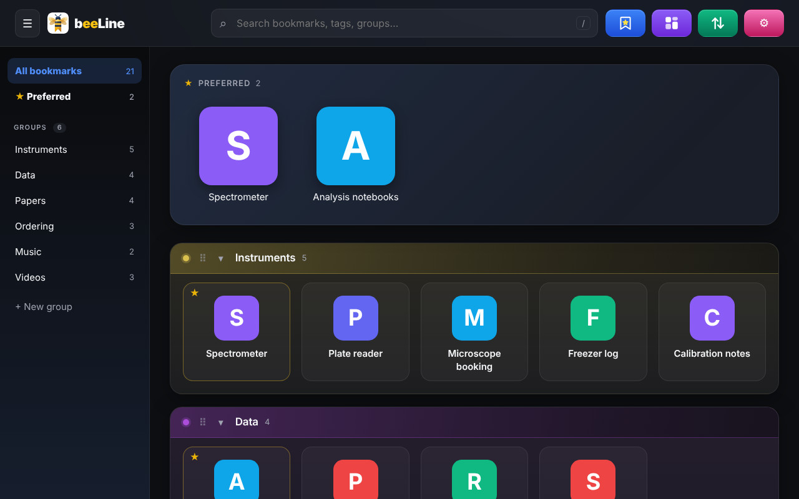
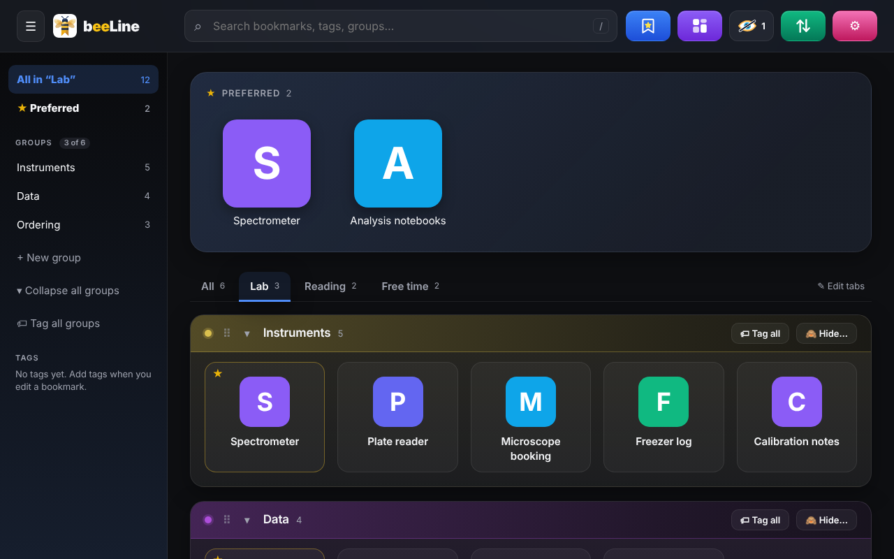
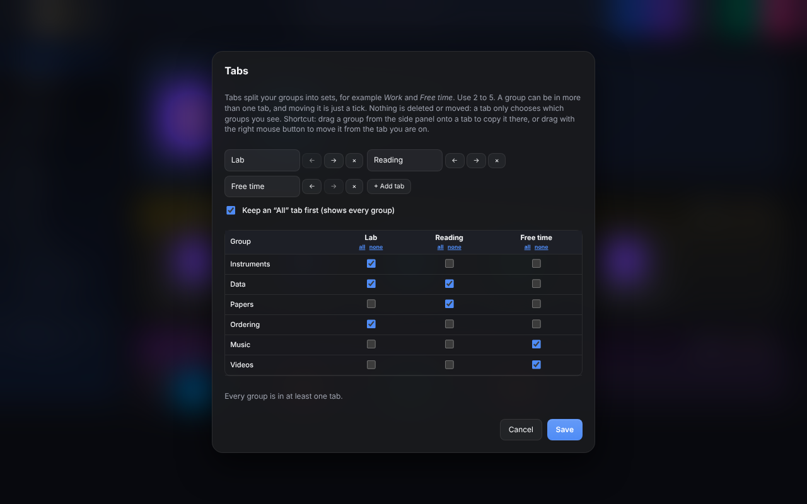
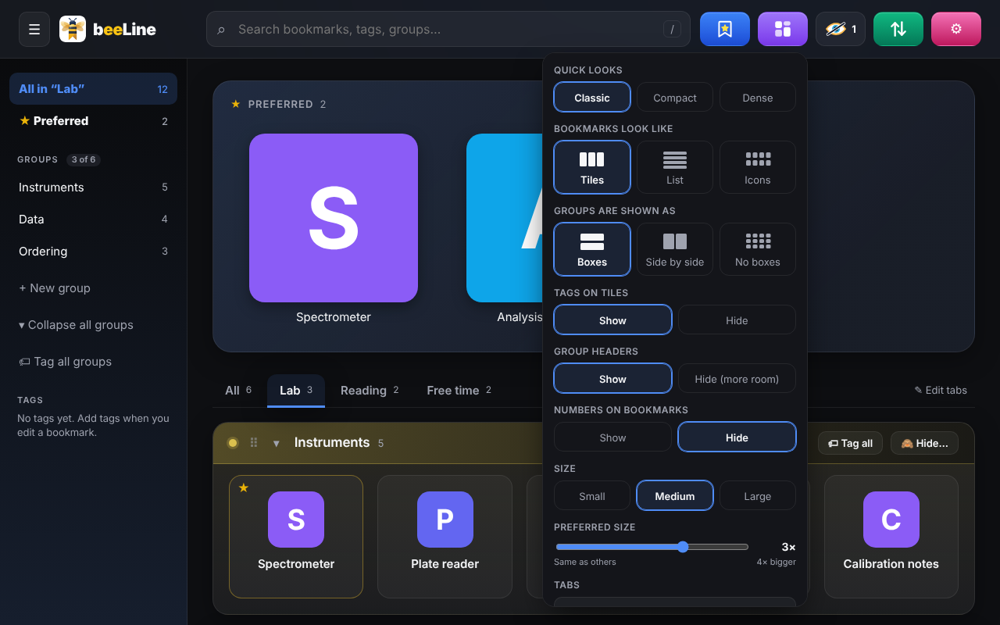
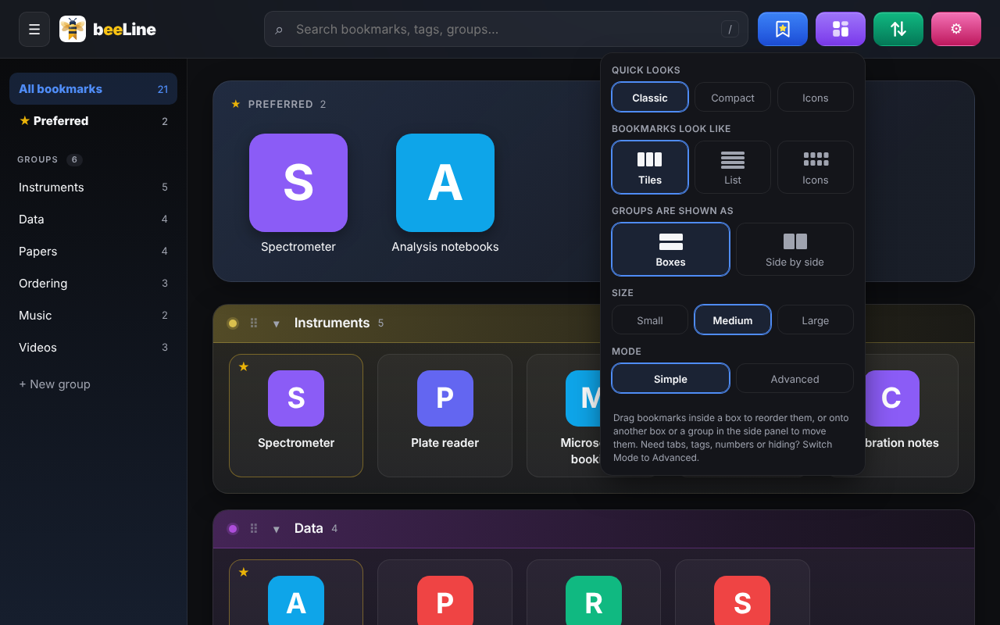
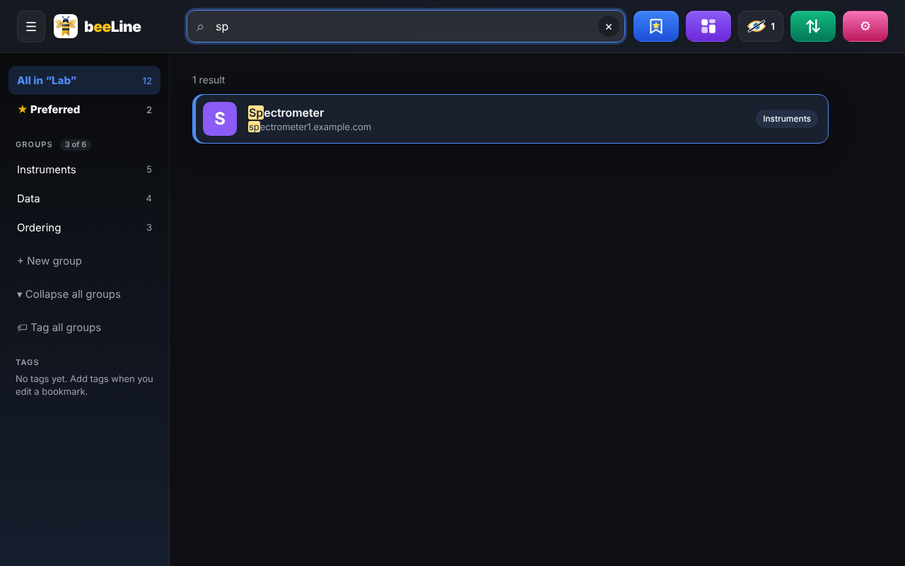

# Beeline

A visual bookmark dashboard for your browser's New Tab page. Chrome, Brave and Firefox. Local-first: no account, no server, no tracking.

> Status: **beta** (v2.7.0). Used daily in Chrome and Brave; the Firefox build works but has less testing and no automatic sync.
>
> **Desktop only for now.** Beeline is a desktop-browser extension (Chrome, Brave, Firefox on Windows, macOS and Linux). Phones and tablets are not supported in this release; the layout adapts to narrow windows and has touch gestures, but there is no mobile app or web version yet.

Use it as a plain bookmark page, or as a quick personal start page or lab dashboard: group your instruments, data, papers and daily sites into tabs.

The story of how Beeline is being built, one step at a time with AI, is on the blog [The Daily Calf](https://rosariosai.substack.com).

## Brochure

A two-page A4 brochure (PDF), made with AI help: [docs/brochure/beeline-brochure.pdf](docs/brochure/beeline-brochure.pdf). How it was made: [the blog post](https://rosariosai.substack.com).

## Screenshots

Simple by default (Chrome, dark theme, sample data):

Tabs split your groups into sets, for example for a lab or for free time:

Choose which groups appear in which tab with a simple checkbox grid:

Preferred size slider and the View menu:

Switch between Simple and Advanced mode at any time; nothing is lost:

Instant search:

## What it does

- Tiles, list or icon layouts, in small, medium or large sizes; groups stacked or side by side, or a flat "raw" view with no groups at all.
- **Preferred** launchpad at the top for the bookmarks (or whole groups) you use most.
- Groups with colours and emoji, drag and drop reordering, tags, fast search, numbers on tiles so you can jump with the keyboard.
- Hide bookmarks or groups (until a date, or for good) and show them again with the eye button.
- Per-browser groups ("Top Chrome", "Top Brave", "Top Firefox") and built-in links to each browser's extensions page, handy while developing.
- Icons: site icon from the browser's cache, your own upload with cropping, an image address, or a built-in glyph.
- Import from the browser, a bookmarks HTML file or a JSON backup; export a backup at any time.
- **Sync between Chrome and Brave** through one file in a folder you choose (for example a cloud-drive folder). Firefox cannot keep a file linked, so use backup and import there.

## Install

- **Chrome and Brave:** [Beeline on the Chrome Web Store](https://chromewebstore.google.com/detail/beeline-%E2%80%94-bookmark-dashbo/jliligpephbbdhejkhipflpdefapgbeo)
- **Firefox:** [Beeline on Firefox Add-ons](https://addons.mozilla.org/en-US/firefox/addon/beeline-bookmark-dashboard/)

### From source

Requires Node.js 20 or newer.

    npm install
    npm run build        # writes dist/chrome and dist/firefox

- **Chrome / Brave:** open `chrome://extensions` (or `brave://extensions`), turn on Developer mode, **Load unpacked**, choose `dist/chrome`, open a new tab.
- **Firefox:** open `about:debugging#/runtime/this-firefox`, **Load Temporary Add-on...**, choose `dist/firefox/manifest.json`. Firefox forgets temporary add-ons when it closes.

More detail, sync and settings: [docs/INSTALL.md](docs/INSTALL.md).

## Develop

    npm test             # unit tests (vitest + fake-indexeddb)
    npm run typecheck
    npm run dev          # rebuild dist/chrome on every change (reload the extension in the browser)
    npm run zip          # release/*.zip packages

Pure logic lives in `src/core` and is covered by tests; screens are in `src/ui`; browser APIs in `src/browser`; storage in `src/data`. Optional end-to-end scripts in `scripts/` need Playwright (not a dependency). See [CONTRIBUTING.md](CONTRIBUTING.md).

## Privacy

Everything stays in your browser's local storage. No network requests except the ones your browser makes when you open a bookmark. Details and permissions: [docs/PRIVACY.md](docs/PRIVACY.md).

## Documents

[Changelog](docs/CHANGELOG.md) · [Install and settings](docs/INSTALL.md) · [Privacy](docs/PRIVACY.md) · [Firefox test list](docs/FIREFOX-CHECKLIST.md)

## Licence

[MIT](LICENSE). Copyright (c) 2026 Rosario Savoia.
